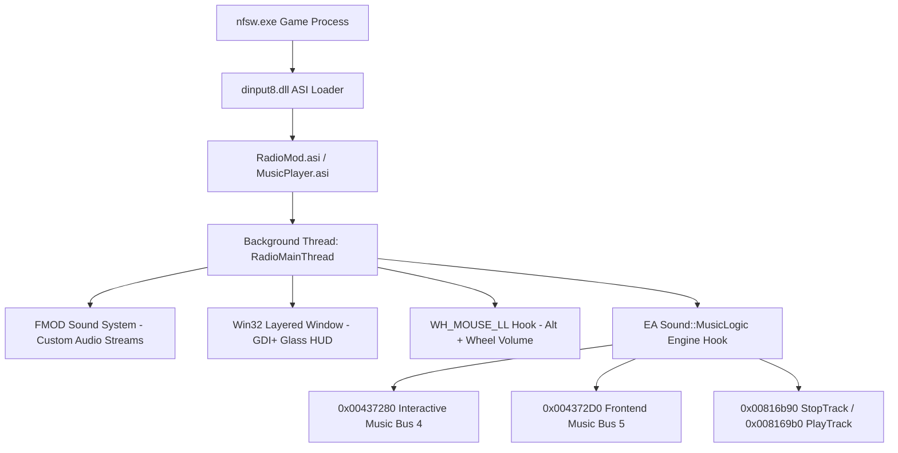

# NFS World Custom Radio & Music Player Mod

## Project Overview

The objective of this project was to understand the internal audio mechanisms of **Need for Speed World** (`nfsw.exe`) and build a modern, customizable in-game audio experience. Originally conceived as a lightweight radio mod, the project evolved into an architectural investigation of Electronic Arts' proprietary sound engine, resulting in two distinct, production-grade mods and a dedicated visual tooling suite:

1. **`Radio` (`Radio.asi`)**: A hybrid dual-engine player. It embeds **FMOD** to stream custom user playlists (MP3, FLAC, WAV, OGG, AAC) from `Sound\Radio\<Station>\`, features a fully skinnable GDI+ glass overlay with live album art extraction, and automatically silences/takes over the game's native audio engine. When paused, controls dynamically switch to operating the in-game soundtrack.
2. **`MusicPlayer` (`MusicPlayer.asi`)**: A standalone, zero-FMOD in-game soundtrack manager. It hooks directly into EA's `Sound::MusicLogic` subsystem to expose, categorize, and cycle through all 66 internal interactive soundtrack stems (Freeroam, Pursuit, Race, Drag, Safehouse, Team Escape), complete with shuffle decks, playlist filters, and an on-screen HUD popup.
3. **`SkinBuilder` (`skin_builder.html`)**: A client-side visual authoring workspace (HTML5 Canvas / CSS3 / Vanilla JS) created to visually design, preview, and export JSON layout definitions for the Radio overlay.

---

## Reverse Engineering: Game Audio Subsystem

### The Architectural Crossroads: Scaleform GFx vs. Win32 ASI

At the start of the project, two potential avenues were evaluated:
- **Approach A: Flash / Scaleform GFx (.gfx)**
- **Approach B: Native C++ ASI Plugin (.asi)**

A systematic audit of the game's Flash UI (`World/GFX`) and ActionScript 2.0 bindings via FFDec revealed severe technical blockers for a GFx-only mod:
1. **No Filesystem Access**: ActionScript 2.0 running inside Autodesk Scaleform has no operating system directory traversal APIs (`FindFirstFile` / `readdir`). It cannot discover folders or files dropped into `Sound\Radio\`.
2. **Missing Codec Decoders**: While Flash provides a `Sound.loadSound()` primitive, NFSW's Scaleform integration did not bind external MP3/OGG streaming audio codecs to the Flash runtime.
3. **View Lifetime & Teardown**: Flash UI movies in NFSW are transient. Transitioning from the Safehouse into Freeroam, entering an Event, or triggering a Police Pursuit tears down active `.gfx` movie views, killing playback.

**Decision**: The mod was developed as a native 32-bit Win32 ASI dynamic library (`.asi`), loaded automatically on process initialization by `dinput8.dll`.


---

### Cracking EA's `Sound::MusicLogic` Engine

Deep disassembly using Capstone and live process inspection in `nfsw.exe` uncovered the proprietary EA Interactive Sound Subsystem:

#### 1. The `MusicLogic` Instance & VTable
- The virtual method table for `Sound::MusicLogic` is fixed at `0x00BD8A0C` (relocated dynamically by ASLR base delta).
- Offset `+0x24` in this vtable (`0x00BD8A30`) is `MusicLogic::Update`, called on every audio frame tick.
- By placing a VirtualProtect-hook on `0x00BD8A30`, the mod intercepts the `this` pointer (`ECX` via `__fastcall`) on tick 1, securing an instant handle to the live `MusicLogic` object.

#### 2. The Internal Soundtrack Table
Located at offsets `+0x64` (`table_start`) and `+0x68` (`table_end`) inside `MusicLogic`:
- Each track entry is exactly **264 bytes (`0x108`)**:
  ```cpp
  #pragma pack(push, 1)
  struct InGameTrackEntry {
      uint32_t trackId;     // Unique EA sound hash / stem identifier
      uint32_t param1;      // Audio configuration flags
      char     path[256];   // Relative path (e.g., "sound\\Music\\Race_01.sns")
  };
  #pragma pack(pop)
  ```
- Memory scans confirmed **66 official soundtrack entries** compiled into the binary, spanning:
  - Freeroam ambient stems (`freeroam_01` – `freeroam_04`)
  - Race themes (`Race_00` – `Race_27`, `RaceChristmas`)
  - Pursuit themes (`pursuit_01` – `pursuit_05`)
  - Team Escape themes (`teamescape_01` – `teamescape_05`)
  - Drag Race themes (`DragRace_02` – `05`, `Extreme`, `HeadBanger`)
  - Safehouse music (`Safehouse_01` – `Safehouse_09`, `Hero`, `MeetingPlaceValentinesDay`)

#### 3. Core Engine Callbacks
- **`MusicPlayer_StopTrack` (`0x00816B90`)**: `__thiscall void(void* pLogic)`. Tears down active interactive voices and sets playback state to `2` (`STOPPED`).
- **`MusicPlayer_SelectTrack` (`0x0081DBB0`)**: `__thiscall bool(void* pLogic, uint32_t trackId)`. Searches the `0x108` table for `trackId`, setting pointers at `+0x54` and `+0x58`.
- **`MusicPlayer_PlayTrack` (`0x008169B0`)**: `__thiscall void(void* pLogic)`. Allocates hardware voices for `'MUSC'` stream packets and sets state to `4` (`PLAYING`).
- **`MusicPlayer_SetCrossfade` (`0x00816390`)**: `__thiscall void(void* pLogic, float time, float volume, int unk1, int unk2)`. Adjusts crossfade volume interpolation.

---

## Critical Bugs & Breakthrough Engineering Solutions

### Bug 1: The Startup Access Violation Crash (`0xC0000005`)
- **Symptom**: The game crashed instantly on launch when `RadioMod.asi` was installed.
- **Root Cause**: Early code hooked `MusicLogic::Update` and called `StopTrack` or `SetCrossfade` whenever custom music played. Disassembly of `0x00816B90` and `0x008169B0` showed that the engine unconditionally dereferences voice wrapper pointers:
  - `[pLogic + 0x28]`, `[pLogic + 0x30]`, `[pLogic + 0x38]`, and `[pLogic + 0x40]`.
  During game startup or idle states, these pointers are `NULL`. Calling these functions before the game audio thread allocated voices caused immediate null-pointer dereferences.
  Furthermore, `StopTrack` does not clear `+0x58` (the track path pointer), meaning any condition checking `[pLogic + 0x58] != NULL` would falsely assume a track was active and flood `StopTrack` on every frame tick.
- **Solution**:
  1. Removed destructive voice teardowns from high-frequency update loops.
  2. Implemented strict state guards:
     ```cpp
     uint32_t state = *(uint32_t*)((uintptr_t)pLogic + 0x50);
     uintptr_t pVoice28 = *(uintptr_t*)((uintptr_t)pLogic + 0x28);
     uintptr_t pVoice30 = *(uintptr_t*)((uintptr_t)pLogic + 0x30);
     uintptr_t pVoice38 = *(uintptr_t*)((uintptr_t)pLogic + 0x38);
     if (state == 4 && pVoice28 != 0 && pVoice30 != 0 && pVoice38 != 0) {
         pfnStop(pLogic);
     }
     ```

### Bug 2: MSVC C2712 Exception Handling Conflict
- **Symptom**: Compilation failed with `error C2712: Cannot use __try in functions that require object unwinding`.
- **Root Cause**: MSVC prohibits structured exception handling (`__try / __except`) inside any function containing C++ objects with non-trivial destructors (such as `std::string`, `std::vector`, or RAII locks) when compiled under `/EHsc`.
- **Solution**: Encapsulated all SEH blocks into pure C-style static helper thunks accepting only primitive types (`uintptr_t`, `void*`, `float`), ensuring zero object unwinding frames in SEH boundaries.

### Bug 3: The Simultaneous Playback Paradox
- **Symptom**: While custom radio played, the native in-game soundtrack simultaneously blasted at 100% volume in freeroam and races.
- **Investigation**: The mod was zeroing `[AudioOptionsManager + 0x18]` and `[+ 0x1C]` (`*0x00CE3340`), but disassembly of `0x00437280` revealed that writing to those struct fields in RAM **only updates configuration storage**, without updating hardware mixing buses.
- **Discovery of Real Hardware Bus Setters**:
  ```asm
  0x00437280: ; AudioOptions::SetInteractiveMusicVolume(float* pVol)
    mov eax, dword ptr [0x00ce3340]
    fstp dword ptr [eax + 0x18]
    call 0x0052da90          ; Sound::AudioManager singleton
    mov edx, dword ptr [ecx + 0x2c] ; SetBusVolume virtual function
    push 0
    fstp dword ptr [esp]     ; float volume
    push 4                   ; Bus ID 4 = INTERACTIVE MUSIC BUS
    push eax                 ; AudioManager instance
    call edx                 ; SetBusVolume(this, bus=4, vol, 0)
  ```
  `0x00437280` controls **Bus 4** (Interactive Game Music), and `0x004372D0` controls **Bus 5** (Frontend Safehouse Music).
- **Solution**: Replaced direct memory writes with invocations of `0x00437280` and `0x004372D0`. Setting both buses to `0.0f` silences in-game music at the hardware mixer level. Resuming in-game music restores both buses to `g_inGameMusicVolume`.

---

## Technology Stack & Tools Used

### Core Technologies
- **Microsoft Visual C++ (MSVC x86, v145)**:
  - Compiled with `/O2 /MT /EHsc /utf-8`.
  - Static C Runtime (`/MT`) ensures the generated `.asi` binaries have zero runtime dependencies on VC++ redistributables, relying solely on Windows system DLLs (`KERNEL32`, `USER32`, `GDI32`, `GDIPLUS`).
- **FMOD Low-Level Audio Engine (`fmod.dll`)**:
  - Dynamically resolved at runtime via `LoadLibraryA` / `GetProcAddress`.
  - Streams high-resolution audio formats (MP3, WAV, FLAC, OGG, AAC) with non-blocking decode channels.
- **GDI+ (Gdiplus.dll)**:
  - Used for antialiased subpixel text rendering, PNG alpha channel compositing, and font rendering.
- **Win32 Layered Overlay Architecture**:
  - `WS_EX_LAYERED | WS_EX_TRANSPARENT | WS_EX_TOPMOST | WS_EX_NOACTIVATE | WS_EX_TOOLWINDOW`.
  - Renders directly to an off-screen 32bpp PARGB DIB section, blitting via `UpdateLayeredWindow`.
  - Click-through transparent; never steals input focus or interrupts fullscreen Direct3D rendering.
- **Low-Level Windows Hooks (`WH_MOUSE_LL`)**:
  - Operates on a dedicated Win32 message-pump thread to capture `Alt + MouseWheel` volume events without interfering with vehicle steering or mouse navigation.

### Reverse Engineering & Diagnostics Tooling
- **Capstone Disassembly Engine (Python)**: Utilized for automated live x86 instruction disassembly from process memory.
- **Win32 Process Memory Auditing (`ReadProcessMemory` / `VirtualQueryEx`)**: Custom Python inspection harnesses (`inspect_game.py`, `check_modules.py`) to inspect live vtables, verify ASLR offsets, and read audio structs.
- **Custom 32-bit Remote Thread Injector (`inject32.exe`)**: Built to load, hot-patch, and test `.asi` routines directly inside the running `nfsw.exe` process without needing to restart the game during development.
- **Ghidra**: Used to analyze the initial 36MB decompilation dump (`nfsw.c`).
- **FFDec (JPEXS Free Flash Decompiler)**: Used to inspect NFSW's Scaleform ActionScript 2.0 bytecode and determine Scaleform integration limits.

---

## AI Usage & Human-AI Collaborative Workflow

This project was built through pair-programming between the developer and agentic AI coding assistant. 

### Key Areas of AI Contribution

1. **Unattended Binary & Memory Forensics**:
   - Rather than guessing offsets, the AI authored on-the-fly Python scripts using `capstone` and `ctypes` to disassemble game routines directly out of running memory (`nfsw.exe`).
   - Identified that `0x008169B0` (`PlayTrack`) and `0x00816390` (`SetCrossfade`) dereference `[ESI + 0x40]`, explaining why uninitialized calls produced instant `0xC0000005` Access Violations.
   - Identified that `0x00437280` pushed `4` and `0x004372D0` pushed `5` to the audio bus dispatcher, unlocking hardware-level muting.

2. **Self-Healing Compilation & Exception Hardening**:
   - When MSVC failed with `C2712` due to structured exception handling colliding with standard library destructors, the AI refactored the exception architecture into pure POD thunks without human intervention.

3. **Live Process Patching**:
   - When bugs occurred while the game was open, the AI wrote remote-thread shellcode stubs in Python to hot-patch memory functions live in `nfsw.exe`, verifying hypotheses without forcing the developer to repeatedly restart the game client and sit through loading screens.

4. **Architectural Modularization**:
   - Transformed a monolithic 4,400-line single-file proof-of-concept into clean, modular C++ components (`Radio`, `MusicPlayer`, `InGameMusic`, `RadioSkin`, `RadioPopup`, `RadioConfig`, `MetadataExtractor`) with clean header encapsulation.